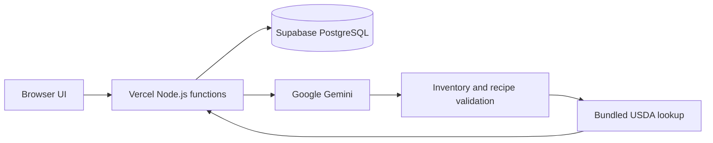

# Architecture

FridgeOps is a small serverless application with explicit boundaries between
untrusted model output, validated domain data, and persistence.

## Request flow

1. `api/auth.js` issues a signed, seven-day HttpOnly visitor cookie. An optional
   shared code restricts demo entry.
2. `api/sessions.js` scopes reads and writes to that visitor. Updates compare the
   current revision, so simultaneous tabs cannot silently overwrite each other.
3. `api/vision.js` accepts up to three bounded, signature-checked image payloads,
   claims an AI attempt, and asks Gemini for structured ingredient observations.
   Images are not written to the database.
4. The user reviews the draft and explicitly saves inventory.
5. `api/recipes.js` loads saved inventory, claims an attempt, requests JSON recipes,
   and validates IDs, units, duplicates, exclusions, and known quantity bounds.
   Provider failure or rejected output triggers labelled templates.
6. `lib/domain.js` estimates per-serving nutrients using exact aliases in a bundled
   16-food USDA snapshot. Unmapped ingredients are reported as missing coverage.

## Engineering choices

- Plain browser JavaScript and native Node APIs keep runtime dependencies at zero.
- Model output never writes directly to storage; server-side validation is the gate.
- PostgreSQL enforces the daily quota atomically with a transaction advisory lock.
- Database and model requests have timeouts. Unknown nutrition remains explicit.
- The UI constructs text nodes instead of injecting model-generated HTML. The Vercel
  configuration adds CSP, frame restrictions, and no-store headers.

## Boundaries and tradeoffs

The hosted version does not include the former Python agent, replay engine, or
evaluation datasets. Recipe validation checks structured ingredients; it cannot
prove that every natural-language cooking instruction is safe or feasible. A
confirmed product list still needs human review, and separate recipe ideas do not
reserve stock across a multi-meal plan.

Sessions are browser-scoped, not cross-device accounts. Clearing the cookie loses
access to saved sessions. Before broader production use, introduce durable user
identity, retention/deletion controls, stronger abuse protection, and monitored
provider budgets appropriate to the expected traffic.
